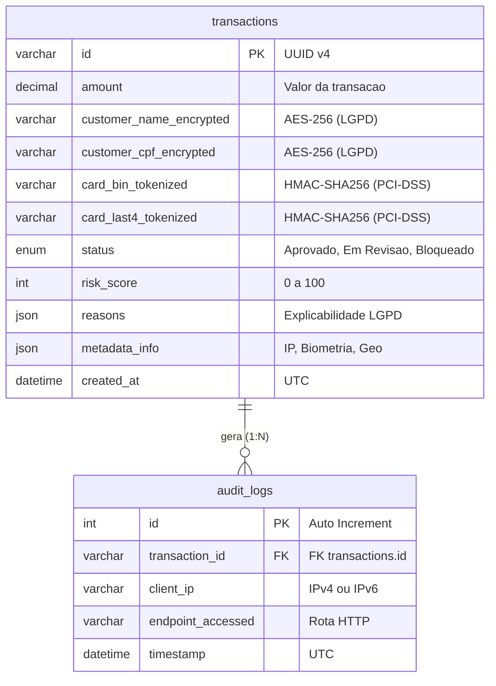

# AegisGate: API de Detecção de Fraudes em E-commerce

**AegisGate** é um microsserviço REST de alta performance e resiliência focado em avaliação e mitigação de risco de fraudes em transações de checkout em tempo real, construído com conformidade estrita à **LGPD** e ao **PCI-DSS**.

---

## Visão Geral do Sistema

O **AegisGate** atua como um escudo e intermediário crítico entre o checkout da plataforma de e-commerce e o gateway de pagamento:
1. Recebe os dados comportamentais e da transação via requisição autenticada (JWT) com validação semântica estrita na borda (Pydantic V2).
2. Avalia o risco probabilístico de fraude utilizando **Arquitetura Híbrida de Inteligência Artificial (v2.0)**: modelo supervisionado de Machine Learning (Scikit-Learn RandomForestClassifier) integrado a uma camada de regras semânticas de explicabilidade (LGPD Art. 20), biometria de checkout e anomalias geográficas (GeoIP2).
3. Classifica a transação em:
   * **Aprovado** (Score < 60)
   * **Em Revisão** (Score entre 60 e 84)
   * **Bloqueado** (Score >= 85)
4. Persiste o registro de forma segura, com **criptografia em repouso (AES-256)** para dados sensíveis e **tokenização determinística (HMAC-SHA256)** para cartões.
5. Garante idempotência e semântica REST: tentativas de reprocessamento do mesmo `transaction_id` retornam **HTTP 409 Conflict**.
6. Registra logs de auditoria de forma **assíncrona em background** para manter o tempo de resposta do checkout ultrarrápido.
7. Protege os endpoints com **Rate Limiting** via Redis (com salvaguarda resiliente *Fail-Open*).
8. Disponibiliza um **Dashboard de Risco & Backoffice** integrado (`/dashboard`) com visual moderno em tema escuro, gráficos analíticos interativos, mascaramento LGPD em tempo de visualização e um **Simulador de Checkout (1-Click)** para demonstração em tempo real.

---

## Tecnologias Utilizadas

* **Linguagem & Framework:** Python 3.11 + [FastAPI](https://fastapi.tiangolo.com/) com ciclo de vida assíncrono (*Lifespan*)
* **Frontend & Dashboard:** HTML5 semântico, Vanilla CSS moderno (Dark Theme e Glassmorphism) e JavaScript nativo (ES6+) com [Chart.js](https://www.chartjs.org/) embutido (zero dependências de Node.js ou npm)
* **Machine Learning & Inteligência Artificial:** [Scikit-Learn](https://scikit-learn.org/), [NumPy](https://numpy.org/) e [Joblib](https://joblib.readthedocs.io/) com pipeline de treinamento determinístico (Random Forest) e inferência probabilística contínua
* **Configuração & Validação:** [Pydantic V2](https://docs.pydantic.dev/) e [pydantic-settings](https://docs.pydantic.dev/latest/concepts/pydantic_settings/) com validação de segurança *fail-fast* no boot
* **ORM & Banco de Dados:** [SQLAlchemy 2.0](https://www.sqlalchemy.org/) (`DeclarativeBase`) com índices otimizados, suporte a MySQL 8.0 e SQLite para testes locais
* **Cache & Rate Limiting:** [Redis](https://redis.io/) com política de resiliência *Fail-Open*
* **Resiliência:** [PyBreaker](https://github.com/danielfm/pybreaker) (Circuit Breaker Pattern)
* **Segurança e Criptografia:** `cryptography` (Fernet/AES-256), `hmac` (SHA-256), `secrets` e `PyJWT`
* **Inteligência Geográfica:** MaxMind GeoIP2 (`geoip2`) com consulta opcional e defensiva
* **Testes Automatizados:** [Pytest](https://docs.pytest.org/) com 53 testes automatizados cobrindo 100% dos cenários críticos, pipeline de ML e API do Dashboard

---

## Princípios de Segurança e Compliance

* **LGPD (Lei Geral de Proteção de Dados):**
  * Dados pessoais do titular (Nome, CPF) são encriptados com AES-256 no banco de dados.
  * O retorno da API inclui o array explicativo `reasons` para garantir o **Direito à Explicação** em decisões automatizadas.
  * O Dashboard de risco aplica mascaramento dinâmico em tempo de exibição (`C*** S****`, `***.***.789-00`), impedindo vazamento de dados sensíveis para operadores de tela.
* **PCI-DSS:**
  * O código de segurança (CVV) **nunca** é recebido nem armazenado.
  * BIN e últimos 4 dígitos do cartão são tokenizados via HMAC determinístico com salt seguro, permitindo identificar reincidência de cartões clonados sem expor os dígitos reais.
* **Autenticação e Rate Limiting Obrigatórios (RN01 / RNF001):**
  * Emissão de JWT condicionada à validação estrita de credenciais de parceiros homologados via comparação em tempo constante (`secrets.compare_digest`).
  * Endpoints sensíveis protegidos por limitador de taxa (*Rate Limiting*) para prevenção de ataques de força bruta e DoS.
* **Validação Estrita na Borda (Perimeter Defense):**
  * Bloqueio imediato (HTTP 422) de timestamps retroativos (`submitted < started`), siglas de UFs inexistentes, formatos de IP inválidos e CPFs malformados.
* **Circuit Breaker (RN06):**
  * Caso o motor de IA falhe repetidamente ou fique indisponível, o circuito abre automaticamente e ativa a regra de contingência (*fallback*), enviando a transação para `"Em Revisão"` sem interromper as vendas do lojista.

---

## Estrutura do Projeto

```text
Projeto/
├── docs/                           # Documentação técnica e de negócio
│   ├── api/                        # Contrato OpenAPI (openapi.yaml)
│   ├── arquitetura/                # Diagramas C4 Model
│   ├── banco_de_dados/             # Modelagem MER e schemas DDL
│   ├── compliance/                 # Relatório de Impacto à Privacidade (RIPD / LGPD)
│   ├── requisitos/                 # Documentos de Requisitos e Definição do Projeto
│   └── historico/                  # Registro de Planos e Decisões de Arquitetura
├── scripts/                        # Scripts de automação e treinamento de Machine Learning
│   └── train_ml_model.py           # Pipeline executável de treinamento e métricas da Random Forest
├── src/
│   ├── api/                        # Controladores e rotas HTTP (FastAPI)
│   │   └── routers/                # auth_router.py, transaction_router.py e dashboard_router.py
│   ├── core/                       # Configurações centrais, segurança, banco, exceções e rate limiting
│   │   ├── config.py               # Pydantic Settings com validações fail-fast de produção
│   │   ├── database.py             # SQLAlchemy 2.0 DeclarativeBase e engine pool
│   │   ├── exceptions.py           # Exceções de domínio (DuplicateTransactionError)
│   │   ├── rate_limiter.py         # Rate limiter resiliente backed por Redis
│   │   └── security.py             # JWT Service e autenticação em tempo constante
│   ├── ml/                         # Módulo de Machine Learning supervisionado
│   │   ├── dataset_generator.py    # Gerador de dataset sintético determinístico
│   │   ├── fraud_model.joblib      # Artefato serializado do modelo treinado (Random Forest)
│   │   └── trainer.py              # Classe orquestradora de treino e avaliação
│   ├── models/                     # Entidades ORM (domains) e DTOs Pydantic V2 (schemas)
│   ├── services/                   # Regras de negócio (TransactionService, DashboardService, FraudAI, Audit)
│   └── static/                     # Interface Web do Dashboard de Risco e Simulador (SPA)
│       ├── css/dashboard.css       # Design System responsivo em Dark Mode com Glassmorphism
│       ├── js/dashboard.js         # Cliente assíncrono com consultas e controle do simulador
│       ├── vendor/chart.umd.min.js # Chart.js minificado e empacotado localmente (100% offline)
│       └── index.html              # Estrutura semântica do Dashboard
├── tests/                          # Suíte de testes automatizados com pytest (53 testes)
│   ├── test_auth.py                # Testes de autenticação de lojistas parceiros
│   ├── test_config.py              # Testes de configurações e invariantes de segurança
│   ├── test_dashboard_api.py       # Testes de métricas, simulação, deliberação e mascaramento LGPD
│   ├── test_exceptions.py          # Testes da hierarquia semântica de exceções DDD
│   ├── test_fraud_api.py           # Testes de fluxos E2E, antifraude e Circuit Breaker
│   ├── test_hybrid_ai.py           # Testes do motor híbrido de IA e pipeline de ML
│   ├── test_rate_limiter.py        # Testes de fail-open e limites de taxa
│   └── test_schemas.py             # Testes de borda e validações Pydantic V2
├── docker-compose.yml              # Serviços de infraestrutura (MySQL 8 e Redis)
├── requirements.txt                # Dependências do projeto
└── README.md                       # Documentação principal
```

---

## Modelagem do Banco de Dados (DER)

O banco de dados relacional é estruturado em duas entidades principais conectadas por cardinalidade 1:N, separando os registros de checkout avaliados pela inteligência artificial da trilha imutável de auditoria:



* **Conformidade LGPD:** Dados pessoais (Nome, CPF) são encriptados com AES-256 no banco de dados. O array `reasons` garante o Direito a Explicacao (Art. 20).
* **Conformidade PCI-DSS:** O numero do cartao nao e armazenado em texto claro; apenas hashes com HMAC-SHA256 deterministico e salt sao persistidos. O codigo de seguranca (CVV) nunca e recebido nem armazenado.

---

## Como Executar Localmente

### 1. Pré-requisitos
* Python 3.11+ instalado
* Git instalado
* Docker e Docker Compose (opcional; necessário apenas caso deseje executar instâncias dedicadas de MySQL e Redis)

### 2. Configurar o Ambiente Virtual
No terminal (PowerShell no Windows):
```powershell
# Criação do ambiente virtual
python -m venv venv

# Ativação do venv
.\venv\Scripts\Activate.ps1

# Instalação das dependências
pip install -r requirements.txt
```

### 3. Configurar as Variáveis de Ambiente
Copie o arquivo de exemplo `.env.example` para `.env`:
```powershell
Copy-Item .env.example .env
```

### 4. Subir a Infraestrutura (MySQL e Redis - Opcional)

Se desejar executar a infraestrutura idêntica à de produção:
```powershell
docker compose up -d
```
> **Nota:** Em desenvolvimento local, o uso do Docker é **opcional**. Por padrão (`ENVIRONMENT=development`), o sistema utiliza banco SQLite local (`fraud_test.db`) e possui resiliência com *fail-open* para o rate limiter caso o Redis não esteja ativo.

### 5. Treinar ou Atualizar o Modelo de Machine Learning (Opcional)
O artefato já se encontra pré-treinado e serializado em `src/ml/fraud_model.joblib`. Para reexecutar o treinamento e inspecionar acurácia, F1 e ROC-AUC:
```powershell
python scripts/train_ml_model.py
```

### 6. Iniciar a API e o Dashboard
```powershell
uvicorn src.main:app --reload --host 0.0.0.0 --port 8000
```
* **Dashboard de Risco & Simulador:** [http://localhost:8000/dashboard](http://localhost:8000/dashboard) (ou acesse a raiz `http://localhost:8000/`)
* **Documentação Swagger Interativa:** [http://localhost:8000/docs](http://localhost:8000/docs)
* **Documentação ReDoc:** [http://localhost:8000/redoc](http://localhost:8000/redoc)

---

## Executando os Testes Automatizados

A suíte de testes utiliza um banco SQLite em memória isolado para garantir que a base de dados de desenvolvimento não seja poluída:

```powershell
pytest -v
```

A suíte abrange 53 testes automatizados organizados em 8 módulos coesos:
* `tests/test_auth.py`: Autenticação e bloqueio de lojistas não autorizados.
* `tests/test_config.py`: Validação de invariantes de segurança e URLs de banco.
* `tests/test_dashboard_api.py`: Métricas analíticas, simulador de checkout, deliberação manual e mascaramento LGPD.
* `tests/test_exceptions.py`: Hierarquia semântica de exceções DDD (Conflict, Auth, Validation, Infra).
* `tests/test_schemas.py`: Validações de borda (datas retroativas, UFs brasileiras, IPv4/IPv6, CPF, cartões).
* `tests/test_rate_limiter.py`: Política de resiliência fail-open e bloqueio HTTP 429.
* `tests/test_fraud_api.py`: Caminhos felizes, regras comportamentais, Circuit Breaker, 409 Conflict, anonimização LGPD e auditoria em background.
* `tests/test_hybrid_ai.py`: Testes do modelo de Machine Learning, determinismo de geração de dados sintéticos, resiliência a artefatos ausentes e explicabilidade LGPD.

---

## Documentação Complementar

* [Modelagem do Banco de Dados (MER)](docs/banco_de_dados/Modelagem_MER.md)
* [Relatório de Impacto à Proteção de Dados (RIPD / LGPD)](docs/compliance/RIPD_LGPD.md)
* [Modelagem de Ameaças (STRIDE)](docs/seguranca/Threat_Modeling_STRIDE.md)
* [Arquitetura C4 Model](docs/arquitetura/C4_Model.md)
* [Especificação de Requisitos](docs/requisitos/documento_requisitos_sistema.txt)
* [Registro de Planos e Decisões de Arquitetura](docs/historico/registro_planos_e_decisoes.md)

---

## Licença

Este projeto é distribuído sob os termos da licença **MIT**. Consulte o arquivo [LICENSE](LICENSE) para obter os termos legais completos.
