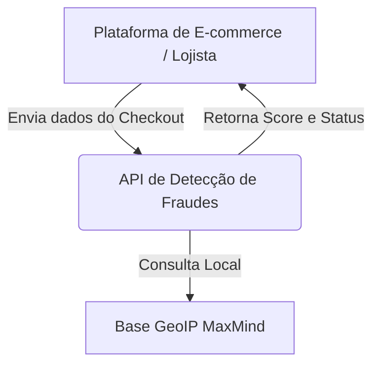
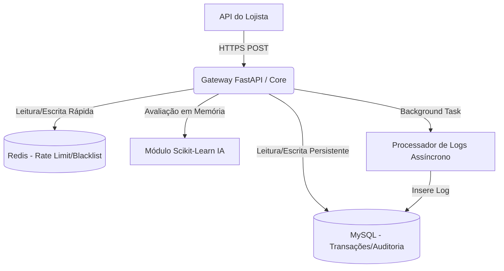

# Documento de Arquitetura de Software (C4 Model)

Este documento descreve a arquitetura do microsserviço de Detecção de Fraudes usando a notação C4 Model.

## 1. Contexto do Sistema (Nível 1)
Descreve como a API se encaixa no ecossistema do E-commerce.

## 2. Diagrama de Contêineres (Nível 2)
Detalha os componentes internos que serão orquestrados via Docker.

