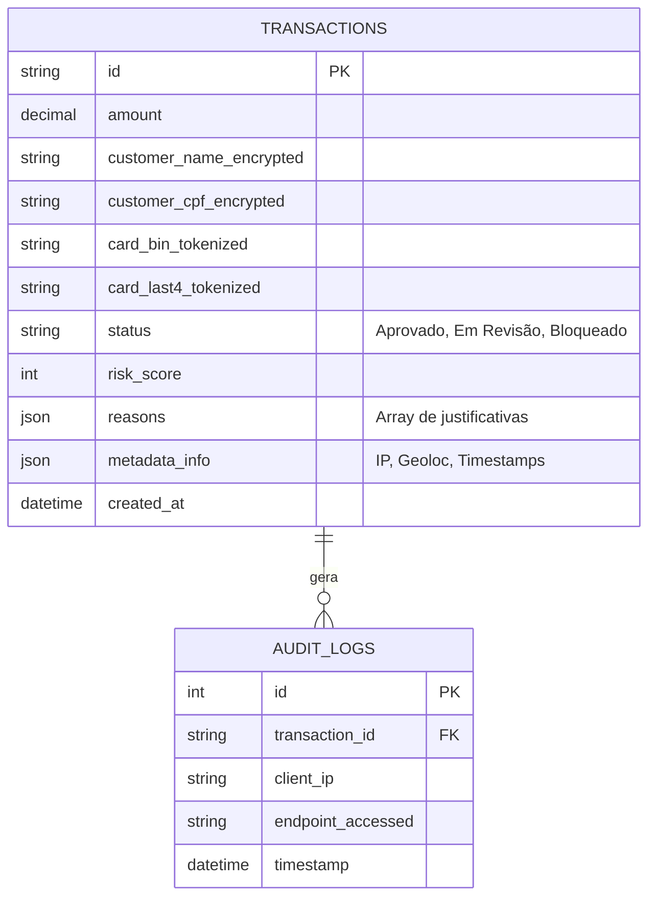

# Modelagem do Banco de Dados

## Diagrama Entidade-Relacionamento (ERD)



## Schemas DDL (MySQL)

```sql
CREATE TABLE transactions (
    id VARCHAR(255) PRIMARY KEY,
    amount DECIMAL(10,2) NOT NULL,
    customer_name_encrypted VARCHAR(512) NOT NULL,
    customer_cpf_encrypted VARCHAR(512) NOT NULL,
    card_bin_tokenized VARCHAR(255),
    card_last4_tokenized VARCHAR(255),
    status ENUM('Aprovado', 'Em Revisão', 'Bloqueado') NOT NULL,
    risk_score INT NOT NULL,
    reasons JSON,
    metadata_info JSON,
    created_at TIMESTAMP DEFAULT CURRENT_TIMESTAMP
);

CREATE TABLE audit_logs (
    id INT AUTO_INCREMENT PRIMARY KEY,
    transaction_id VARCHAR(255),
    client_ip VARCHAR(45) NOT NULL,
    endpoint_accessed VARCHAR(255) NOT NULL,
    timestamp TIMESTAMP DEFAULT CURRENT_TIMESTAMP,
    FOREIGN KEY (transaction_id) REFERENCES transactions(id)
);
```
*(Nota: O campo CVV não existe no schema em conformidade com o PCI-DSS).*
